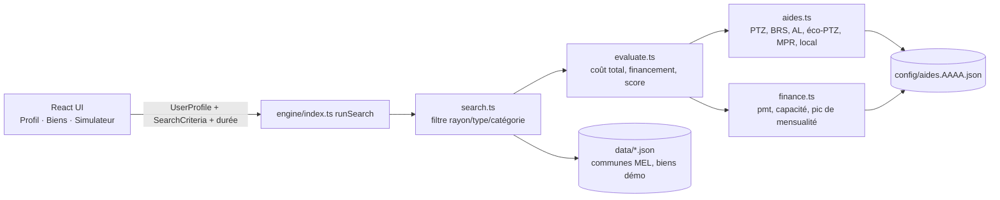

# Architecture ImmoNow

## Vue d'ensemble



MVP 100 % front (React + TypeScript + Vite). Le moteur (`src/engine`) est du TypeScript pur, sans dépendance
à React, donc directement portable vers un backend (Node ou FastAPI) : seule l'interface
`runSearch(profile, criteria, years)` est à exposer en API.

### Architecture cible (production)

| Couche | Choix | Rôle |
|---|---|---|
| Front | Next.js / React | Formulaire, cartes, simulateur « Et si » |
| API | Node (même moteur TS) ou FastAPI | `POST /evaluate`, `GET /biens` |
| Données | PostgreSQL (biens, communes, millésimes de règles) | Remplace les JSON de démo |
| Annonces | Connecteurs (flux partenaires/API) → normalisation en `Property` | Remplace `biens.demo.json` |
| Règles | Fichiers JSON versionnés par millésime, relus au démarrage | Mise à jour annuelle sans code |

## Modèle de données

- **Profil utilisateur** : `UserProfile` dans [`src/types.ts`](src/types.ts) (foyer, primo-accédant, salarié privé, revenus, RFR N-2, apport, crédits en cours).
- **Critères** : `SearchCriteria` (commune centre, rayon km, types, surface, chambres, catégories, travaux acceptés).
- **Règles des aides** : `AidRules`, instancié par [`src/config/aides.2025.json`](src/config/aides.2025.json).
- **Résultat** : `Evaluation` (coût total, aides, plan de financement, prêts, mensualités, reste à vivre, score, statut, alertes).

Exemple de profil :

```json
{
  "foyer": { "adultes": 2, "enfants": 1 },
  "primoAccedant": true,
  "salariePrive": true,
  "finances": { "revenusNetsMensuels": 4200, "rfrN2": 46000, "apport": 30000, "mensualitesCredits": 0 }
}
```

Extrait des règles (PTZ) : plafonds par zone et taille du foyer, 4 tranches de revenus, quotité, durée et différé.

```json
"ptz": {
  "plafondsRessources": { "B1": [34500, 51750, 62100, 72450, 82800] },
  "ratiosTranches": [0.51, 0.64, 0.76, 1.0],
  "tranches": [{ "dureeTotaleAns": 25, "differeAns": 15 }]
}
```

## Hypothèses du moteur

- Capacité d'emprunt = (35 % × revenus − crédits en cours) / facteur de mensualité (taux de la grille + assurance 0,34 %/an).
- Le prêt bancaire est dimensionné sur la **mensualité pic** (PTZ remboursé inclus) pour ne jamais dépasser 35 % à aucun moment.
- Ordre de mobilisation : apport → subventions → PTZ → Action Logement → Éco-PTZ → prêt bancaire ; le reste est le « manque ».
- Score = ressources mobilisées / coût total. Vert = financé et reste à vivre ≥ seuil ; Orange = écart ≤ 10 % ou reste à vivre sous le seuil ; Rouge sinon (ou BRS hors plafond).
- Frais de notaire : 2,5 % neuf/BRS, 8 % ancien/HLM. Travaux = surface × forfait €/m² par DPE (ancien/HLM uniquement).

## Limites connues

Barèmes **indicatifs et simplifiés** (millésime 2025) : à faire valider avant tout usage réel. Pas de temps de trajet
(rayon à vol d'oiseau), pas de PSLA, pas de zonage fin PTZ, pas de persistance ni d'authentification dans le MVP.
